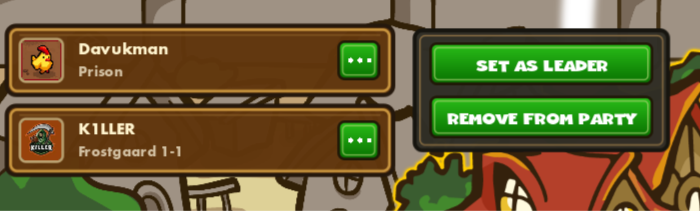

# Party Auto Join

<!-- drh:show -->
Automatically join your chosen leader's game wherever they are, whenever joining is possible. Once auto mode is enabled, Party Auto Join follows them through floors, dungeon changes and restarts, and waits for their next game when they are in town. A movable panel keeps up to four friends and their status in view.

- **First use:** the mod starts enabled. Open a friend's portrait menu to add your first party member; the roster panel appears once a member is added. If previously hidden, press **Ctrl+Shift+P** first.
- **Add friends:** choose **Party +** in a friend's portrait menu. Use the row menu to choose a leader or remove someone.
- **Manual mode:** selecting a leader starts here. No automatic joining, welcome prompts or end-screen restrictions. Normal controls and Dungeon Manager automation work as usual.
- **Auto mode:** click **Join** beside the leader. It waits if they are in town, then follows their floors and restarts. Switching dungeons while playing may ask for confirmation. Normal game admission rules apply. End-screen next/restart automation waits for the leader; loot collection and animation skipping still work.
- **Leader offline:** in auto mode, if friend presence reports the leader offline for five seconds while you are in a dungeon or on its end screen, the mod requests a return to town. Temporary presence outages can trigger this too. When the leader returns, it asks before resuming automatic following. Manual mode never performs this automatic return.
- **Pause Auto Join** returns to manual mode.
- **Ctrl+Shift+P** pauses and hides the panel, stopping background work. Press again to show it in **manual mode**. Your roster and leader are kept.

Hold a row for half a second to drag it. Town and dungeon positions save separately. Rows show friend status, or hero health/mana when playing together. No party invitations are sent. Between stages, recent companions keep their last hero display for up to five seconds while loading; if they have not arrived by then, their row turns grey. This display grace does not change automatic joining or the leader-offline timer.

Upgrading from the previous mod ID: disable or remove the old Party Time Auto Game Joiner copy to avoid running both. Existing party preferences are copied on first launch when available.

### Compatibility

Works alongside [Auto Dungeon / Loot Manager](https://github.com/Drandoxy/DRH-Mod-Auto-Dungeon-Loot-Manager); neither mod replaces the other. While automatically following a leader, Party Auto Join pauses only the manager's automatic Next/Restart actions. Loot collection and animation skipping remain active, and the manager's saved settings are preserved. Returning to manual mode restores normal manager behavior. Both mods can be enabled together; the manager is optional. See its linked page for the description and screenshots.

<!-- /drh:show -->

### Screenshots

Licensed under GPL-3.0; see [LICENSE](LICENSE).

Dialog artwork loading follows [Ultimate Records](https://github.com/Drandoxy/DRH-Mod-Records). Game artwork loads at runtime.
