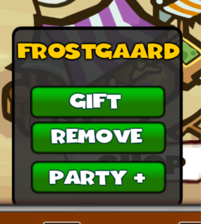
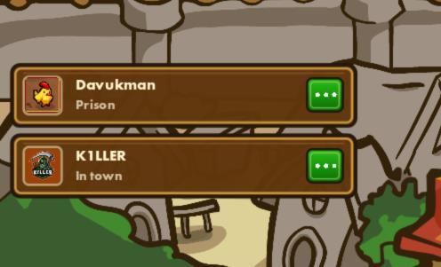
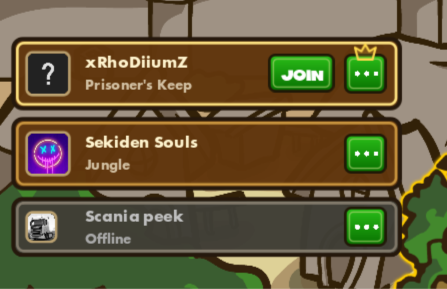
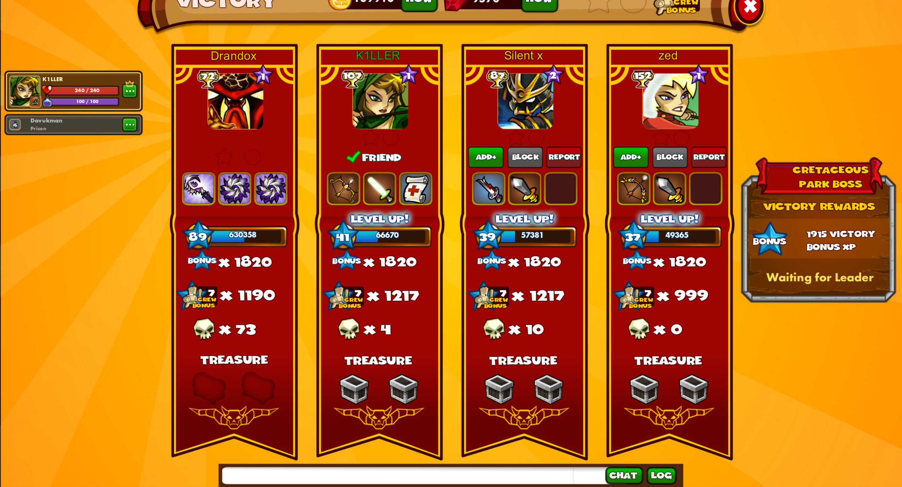

# Party Auto Join

<!-- drh:show -->
Automatically join your chosen leader's game wherever they are, whenever joining is possible. Once auto mode is enabled, Party Auto Join follows them through floors, dungeon changes and restarts, and waits for their next game when they are in Town. A movable panel keeps up to four friends and their status in view.

- **First use:** the mod starts enabled. Open a friend's portrait menu to add your first party member; the roster panel appears once a member is added. If previously hidden, press **Ctrl+Shift+P** first.
- **Add friends:** choose **Party +** in a friend's portrait menu. Use the row menu to choose a leader or remove someone.
- **Manual mode:** selecting a leader starts here. No automatic joining, welcome prompts or end-screen restrictions. Normal controls and Dungeon Manager automation work as usual.
- **Auto mode:** click **Join** beside the leader. It waits while they are in Town, then follows their floors and restarts. Switching dungeons while playing asks for confirmation unless Auto follow everywhere is on. Normal game admission rules apply. End-screen next/restart automation waits for the leader; loot collection and animation skipping still work.
- **Auto follow everywhere** (Settings > Mods, default off): follows the leader on its own, with no prompts. After a floor has loaded the other players, a leader who is not in your dungeon is followed right away, into another dungeon, a new run of the same dungeon, or Town (Town needs one second of Town presence, because a restart passes through Town briefly). Leaving forfeits unclaimed loot, so following waits until the end-screen rewards are finished. Ultimate Rampage runs are never left early.
- **Wait in current dungeon** (Settings > Mods, default off): never leave a live dungeon because party members are missing or offline. Town and end-screen joining still work.
- **Leader offline:** in auto mode, if the leader is reported offline for five seconds while you are in a dungeon or on its end screen, the mod returns to Town. Temporary presence outages can trigger this too. When the leader returns, following resumes (with a prompt unless Auto follow everywhere is on). Manual mode never returns automatically.
- **Pause Auto Join** returns to manual mode.
- **Ctrl+Shift+P** pauses and hides the panel, stopping background work. Press again to show it in **manual mode**. Your roster and leader are kept.

Hold a row for half a second to drag it. Town and dungeon positions save separately. Rows show friend status, or hero health/mana when playing together. No party invitations are sent. Between stages, recent companions keep their last hero display for up to five seconds while loading; if they have not arrived by then, their row turns grey.

The game does not expose dungeon instance IDs, so a new run of the same dungeon is recognized by the leader's presence changing or by their absence from your floor.

Upgrading from the previous mod ID: disable or remove the old Party Time Auto Game Joiner copy to avoid running both. Existing party preferences are copied on first launch when available.

### Compatibility

Works alongside [Auto Dungeon / Loot Manager](https://github.com/Drandoxy/DRH-Mod-Auto-Dungeon-Loot-Manager); neither mod replaces the other. While automatically following a leader, Party Auto Join pauses only the manager's automatic Next/Restart actions. Loot collection and animation skipping remain active, and the manager's saved settings are preserved. Returning to manual mode restores normal manager behavior. Use Auto Dungeon / Loot Manager 0.2.35 or later. Both mods can be enabled together; the manager is optional.
<!-- /drh:show -->

### Screenshots

## Changes since 0.1.67

- Auto follow everywhere: follows without prompts between dungeons, new runs of the same dungeon and Town. A leader move is acted on as soon as the floor has loaded the other players, plus one second.
- Recovers when the leader restarts or moves while you are still loading into their game.
- End-screen rewards (reveal, XP, chests, crates and reward dialogs) always finish before following leaves; there is no reward deadline.
- Ultimate Rampage runs are kept across floors and missing presence.
- New option: Wait in current dungeon.
- A party member with a hero in your dungeon is shown online even if the friends service lags.
- The progression hold for Auto Dungeon / Loot Manager uses a shared overlay marker instead of a cross-mod static lookup.
- No popup when the leader is already in Town; the panel shows it. "In Town" is capitalized.

## Changes since 0.1.86

- Shorter "Wait in current dungeon" description so it shows in full in the MODS tab.
- Fixed the Ultimate Records credit link.

## License and credits

Licensed under GPL-3.0; see [LICENSE](LICENSE).

Dialog artwork loading follows [Ultimate Records](https://github.com/THEYAKUZI/DRH-Mod-Records). Game artwork loads at runtime.
